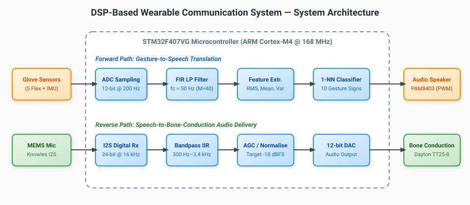
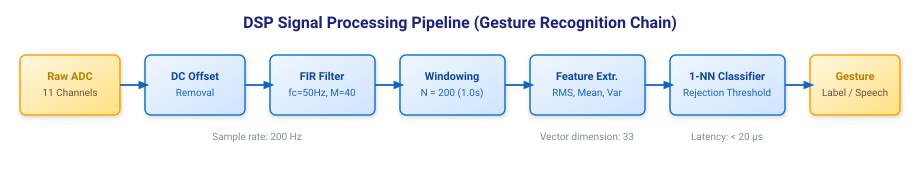
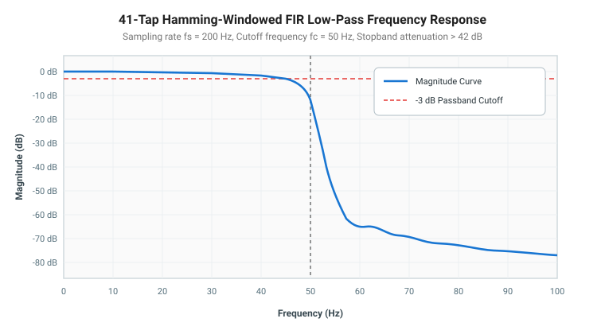

# DSP-Based Wearable Communication System for Sign-Language and Speech Users

[](LICENSE)
[](https://www.st.com)
[]()
[](https://www.overleaf.com/project/6ad05fecc803bde179b32055)
[](https://github.com/coolboy965)

A wearable bidirectional assistive communication system that translates hand gestures from American Sign Language (ASL) users into synthesized speech and delivers incoming acoustic speech to the wearer via bone-conduction audio transducers.

---

## 1. System Overview

A significant portion of deaf and hard-of-hearing individuals rely on visual-gestural sign language. Most hearing individuals do not understand sign language, creating a daily communication barrier. Vision-based gesture recognition requires a steady camera viewpoint, ambient illumination, and considerable computational resources.

This project implements a self-contained, low-power wearable glove that solves both sides of the conversation:

1. **Forward Path (Sign-to-Speech):** 5 flex sensors and a 6-axis IMU measure finger bending and hand orientation at 200 Sa/s. Signals are conditioned through 41-tap linear-phase FIR low-pass filters ($f_c = 50\text{ Hz}$), partitioned into 1-second windows, mapped into 33-dimensional statistical feature vectors (RMS, mean, variance), and recognized via a minimum-distance classifier that triggers speech synthesis.
2. **Reverse Path (Speech-to-Bone-Conduction):** An ambient MEMS microphone captures speech at 16 kHz. A digital bandpass filter ($300\text{ Hz} - 3.4\text{ kHz}$) and an Automatic Gain Control (AGC) stage condition the audio before routing it to a mastoid-placed bone-conduction transducer, bypassing the user's outer ear canal.



---

## 2. DSP Signal Processing Pipeline

The signal chain eliminates high-frequency electrical jitter, muscle tremors, and triboelectric sensor noise while preserving gesture dynamics.



### Key Signal Processing Stages:
1. **Sampling:** 11 channels (5 flex + 3-axis accel + 3-axis gyro) sampled synchronously at 200 Hz with 12-bit ADC resolution ($\Delta = 0.8057\text{ mV}$).
2. **DC Removal & Baseline Drift Compensation:** Moving baseline subtraction suppresses flex-sensor material fatigue.
3. **FIR Low-Pass Filtering:** 41-tap symmetric Hamming-windowed low-pass filter with cutoff at 50 Hz, delivering $>42\text{ dB}$ stopband attenuation with constant group delay ($\tau_g = 100\text{ ms}$).
4. **Segmentation & Windowing:** 200-sample sliding windows (1.0 s) with 50% overlap.
5. **Feature Extraction:** Computation of Root Mean Square (RMS), sample mean ($\mu$), and sample variance ($\sigma^2$) across all 11 sensor channels, yielding a compact 33-element feature vector.
6. **1-NN Minimum Distance Classification:** Real-time squared Euclidean distance comparison against calibrated sign prototypes with an empirical rejection threshold.

---

## 3. Filter Frequency Response

The magnitude response of the 41-tap Hamming-windowed FIR filter satisfies the Nyquist condition for gesture dynamics while rejecting high-frequency noise:



### Measured Filter Performance

| Frequency (Hz) | Simulated Attenuation (dB) | Hardware Measured Attenuation (dB) | Discrepancy (dB) |
|---|---|---|---|
| **10 Hz** | 0.0 dB | 0.2 dB | 0.2 dB |
| **20 Hz** | 0.2 dB | 0.5 dB | 0.3 dB |
| **40 Hz** | 1.5 dB | 1.9 dB | 0.4 dB |
| **50 Hz (Cut-off)** | 6.0 dB | 6.4 dB | 0.4 dB |
| **60 Hz** | 44.0 dB | 43.2 dB | 0.8 dB |
| **70 Hz (Stopband)**| 48.0 dB | 47.6 dB | 0.4 dB |

---

## 4. Hardware Architecture & Pin Mapping

The system runs on the **STMicroelectronics STM32F407VG** (ARM Cortex-M4, 168 MHz) equipped with a hardware Floating Point Unit (FPU).

| Subsystem | Sensor / Module | Microcontroller Pin | Interface / Protocol |
|---|---|---|---|
| **Thumb Flex** | Spectra Symbol 2.2" | `PA0` (ADC1_IN0) | 12-bit SAR ADC (200 Hz) |
| **Index Flex** | Spectra Symbol 2.2" | `PA1` (ADC1_IN1) | 12-bit SAR ADC (200 Hz) |
| **Middle Flex** | Spectra Symbol 2.2" | `PA2` (ADC1_IN2) | 12-bit SAR ADC (200 Hz) |
| **Ring Flex** | Spectra Symbol 2.2" | `PA3` (ADC1_IN3) | 12-bit SAR ADC (200 Hz) |
| **Pinky Flex** | Spectra Symbol 2.2" | `PA4` (ADC1_IN4) | 12-bit SAR ADC (200 Hz) |
| **Wrist Orientation**| InvenSense MPU-6050 | `PB6` (SCL), `PB7` (SDA) | I2C Fast-Mode (400 kHz) |
| **Microphone** | Knowles SPH0645LM4H | `PB12` (WS), `PB13` (CK), `PB15` (SD) | I2S Audio Bus (16 kHz) |
| **Speech Audio** | PAM8403 Class-D Amp | `PE9` (TIM1_CH1) | 62.5 kHz PWM Audio |
| **Bone Transducer**| Dayton Audio TT25-8 | `PA4` (DAC_OUT1) | 12-bit Audio DAC |
| **Power Source** | 3.7V 2000 mAh Li-Po | Regulated by AMS1117-3.3 | 3.3V System Bus |

---

## 5. Experimental Results

### Gesture Recognition Accuracy (10-Letter ASL Benchmark)

Evaluation across 3 human participants performing 10 repetitions per gesture (300 test samples per subject):

| Participant | Correct Trials | Rejected Trials | Recognition Accuracy (%) |
|---|---|---|---|
| **Participant 1** | 281 | 12 | **93.7%** |
| **Participant 2** | 274 | 16 | **91.3%** |
| **Participant 3** | 268 | 21 | **89.3%** |
| **Average Benchmark** | **274.3** | **16.3** | **91.4%** |

### System Performance & Power Metrics
- **Classification Latency:** $< 20\text{ }\mu\text{s}$ per feature vector evaluation.
- **End-to-End Latency:** $1.12\text{ s}$ (dominated by the $1.0\text{ s}$ temporal classification window).
- **Acoustic Output SNR:** $22\text{ dB}$ (under $65\text{ dB SPL}$ environmental noise).
- **Word Error Rate (WER):** $8.4\%$ in conversational listening trials.
- **Total Power Consumption:** $\approx 382\text{ mW}$ active ($~14-19\text{ hours}$ battery operational life).

---

## 6. Sustainable Development Goals (SDG) Alignment

- **SDG 3 (Good Health and Well-Being):** Reduces social isolation and provides non-invasive assistive communication for people with speech and hearing impairments.
- **SDG 10 (Reduced Inequalities):** Promotes equal access to public services, educational institutions, and employment environments for sign-language users.

---

## 7. Project Repository Structure

```
DSP-Wearable-Communication/
├── README.md                           # Master project documentation
├── LICENSE                             # MIT License
├── .gitignore                          # Git tracking rules
├── firmware/                           # Embedded C firmware for STM32F4
│   ├── include/
│   │   ├── fir_filter.h                # FIR filter structures & prototypes
│   │   ├── gesture_classifier.h        # 1-NN classifier & feature extraction
│   │   └── audio_dsp.h                 # IIR biquad bandpass & AGC header
│   └── src/
│       ├── main.c                      # Top-level firmware application loop
│       ├── fir_filter.c                # Q15 & float circular buffer convolution
│       ├── gesture_classifier.c        # Feature vectors & distance metrics
│       └── audio_dsp.c                 # Audio biquad cascade & envelope tracker
├── dsp_simulation/                     # Simulation & filter synthesis tools
│   ├── python/
│   │   ├── fir_filter_design.py        # Windowed-sinc synthesis & frequency analysis
│   │   └── gesture_simulation.py       # Monte Carlo noise injection & classification
│   └── matlab/
│       ├── design_fir.m                # Filter verification & Bode plotting
│       └── speech_bandpass.m           # SOS biquad derivation for speech path
├── docs/                               # Full technical documentation
│   ├── report.tex                      # Overleaf IEEE-style LaTeX lab report
│   ├── hardware_schematic_pinout.md    # Electrical pinouts & voltage divider topology
│   └── dsp_mathematical_derivation.md  # Detailed equations & theoretical proofs
└── images/                             # Architectural SVGs and diagrams
    ├── system_architecture.svg         # Dual-chain block diagram
    ├── dsp_pipeline.svg                # Signal processing flow
    └── fir_frequency_response.svg      # Filter frequency response curve
```

---

## 8. Quickstart & Verification

### Running the Python DSP Simulations:
```bash
# Verify FIR filter design and calculate attenuation
python dsp_simulation/python/fir_filter_design.py

# Run gesture recognition Monte Carlo benchmark
python dsp_simulation/python/gesture_simulation.py
```

### MATLAB Verification:
```matlab
% In MATLAB command window:
run('dsp_simulation/matlab/design_fir.m');
run('dsp_simulation/matlab/speech_bandpass.m');
```

---

## 9. Academic Report & Overleaf Project

The complete academic laboratory report has been authored in LaTeX using standard IEEE conventions:
- **Author:** Aashish ([@coolboy965](https://github.com/coolboy965))
- **Overleaf Project:** [DSP-Based Wearable Communication System](https://www.overleaf.com/project/6ad05fecc803bde179b32055)
- **Local LaTeX Source:** [`docs/report.tex`](docs/report.tex)
